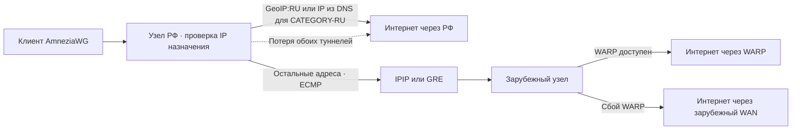

# awg-ru-jump

Инструкция и конфигурации для двух Linux-узлов. Клиент AmneziaWG подключается к узлу в РФ. Соединения к российским сетям и сервисам выходят в интернет из РФ. Остальной публичный IPv4-трафик идёт по туннелю на зарубежный узел, затем через Cloudflare WARP. На клиенте остаётся один профиль VPN и один адрес DNS.

**До начала установки на узле РФ через официальное приложение AmneziaVPN должны быть установлены AmneziaWG и AmneziaDNS.** В приложении выберите нужный сервер, установите AmneziaWG, затем в разделе сервисов установите AmneziaDNS. В настройках соединения включите «Использовать AmneziaDNS». Подключите тестового клиента и проверьте доступ к интернету и работу DNS до изменения маршрутизации. [Скачать приложение](https://amnezia.org/ru/downloads) · [Установка AmneziaWG на свой сервер](https://docs.amnezia.org/ru/documentation/instructions/install-vpn-on-server/) · [Установка и включение AmneziaDNS](https://docs.amnezia.org/ru/documentation/instructions/change-dns/)

## Выбор туннеля

Для связи с зарубежным сервером подходит **любой маршрутизируемый туннель, который передаёт IPv4**. Одного туннеля достаточно. Если туннелей несколько, все они должны вести **на один и тот же зарубежный сервер**. При желании можно включить ECMP, чтобы распределять соединения между туннелями.

Для внутренних адресов удобно выделить каждому туннелю отдельную свободную подсеть из **`100.64.0.0/10`**. Проверьте, что выбранные подсети не пересекаются с сетями узлов и провайдера. В готовом примере используются IPIP с `100.65.1.0/30` и GRE с `100.65.2.0/30`, объединённые в группу ECMP с равными весами.

## Порядок установки

1. Подготовьте два Linux-узла. В проверенной установке публичные IPv4 назначены непосредственно на внешние интерфейсы. Для примера с IPIP и GRE убедитесь, что между узлами проходят **IP-протокол 4** (IPIP) и **IP-протокол 47** (GRE) в обоих направлениях. Если на серверах включен сетевой фильтр, разрешите эти протоколы от адреса второго узла. Числа 4 и 47 обозначают номера IP-протоколов. Открытие одноимённых портов TCP/UDP их не пропускает. Между самими узлами GRE и IPIP передают пакеты без шифрования. [Условия для NAT 1:1 и других туннелей](docs/exit.md)
2. Получите копию репозитория на обоих узлах. Ниже команды выполняются из корня этой копии. Для установки системных файлов и сетевых правил нужны права администратора Linux.

   ```sh
   git clone https://github.com/MeJIuFaRo/awg-ru-jump.git
   cd awg-ru-jump
   ```
3. Замените адреса и имена внешних интерфейсов примера на свои. Публичные адреса в таблице взяты из диапазонов TEST-NET для документации. Сервисные адреса Яндекс DNS и Cloudflare в конфигурациях рабочие. [Шаблон РФ](tunnels/ingress.env.example) · [Шаблон зарубежного узла](tunnels/exit.env.example)
4. Поднимите выбранный туннель или туннели на обоих узлах. В руководстве приведены команды для IPIP и GRE. Затем на зарубежном узле зарегистрируйте собственный профиль WARP, настройте NAT и обратные маршруты. Проверьте каждый путь и выход через WARP до включения маршрутизации клиентов. [Пошаговая установка туннелей и зарубежного выхода](docs/exit.md)
5. На узле РФ установите обработчик DNS, загрузите геобазы и подключите маршрутизацию клиентов. Включите таймеры проверки путей и обновления баз. [Пошаговая установка на узле РФ](docs/ru.md)
6. Выполните проверку с подключённого клиента, включая переключение маршрута, затем проверьте автозапуск. [Приёмка и диагностика](docs/verify.md)

| Параметр | Узел РФ | Зарубежный узел |
|---|---|---|
| Публичный IPv4 в примере | `198.51.100.206` | `203.0.113.124` |
| IPIP, `rn-ipip` | `100.65.1.1/30` | `100.65.1.2/30` |
| GRE, `rn-gre` | `100.65.2.1/30` | `100.65.2.2/30` |
| Клиентский сегмент в примере | `10.8.1.0/24` в `amnezia-awg2` | Ответы возвращаются в исходный туннель |
| DNS, указанный клиенту | `172.29.172.254` | — |

## Как выбирается выход в примере с GRE и IPIP



| Для нового соединения | Маршрут |
|---|---|
| IP назначения входит в `GeoIP:RU` | Напрямую из РФ, в том числе при обращении по IP |
| IP получен из ответа AmneziaDNS на запрос имени из `GeoSite:CATEGORY-RU` | Напрямую из РФ, даже когда адрес сервиса принадлежит иностранной CDN |
| Остальной публичный IPv4, оба туннеля доступны | ECMP с равными весами через IPIP и GRE, далее WARP |
| Один туннель недоступен | Через второй туннель |
| Зарубежный узел доступен, WARP недоступен | Через обычный интернет зарубежного узла |
| Оба туннеля недоступны | Временно через обычный интернет узла РФ |

Выбор между РФ и зарубежным выходом сохраняется в conntrack для каждого потока. ECMP учитывает транспортные порты и распределяет разные потоки; одно TCP-соединение не складывает пропускную способность двух туннелей. На РФ контрольные HTTPS-запросы проверяют каждый путь отдельно каждые 10 секунд. Два последовательных результата меняют его состояние. Для уже оборванного TCP-соединения смена публичного адреса потребует переподключения.

На зарубежном узле правила маршрутизации по меткам проверяют также входной интерфейс пакета. Поэтому совпадение `SO_MARK` у локальной службы, например NetBird, само по себе не отправит её соединение в GRE, IPIP или WARP.

## Как проходит DNS-запрос

- Клиент обращается к AmneziaDNS по UDP или TCP. Правила в контейнере AWG передают эти запросы в mosdns на российском узле. Для имени из `CATEGORY-RU` используется **базовый Яндекс DNS** по DNS-over-TLS (`77.88.8.8`, `77.88.8.1`). Ответы A пополняют два набора nftables на хосте. [Параметры Яндекс DNS](https://dns.yandex.ru/)
- Остальные запросы получает существующий Unbound в `amnezia-dns`. Его основной upstream — **Cloudflare** по DNS-over-TLS (`1.1.1.1`, `1.0.0.1`). Если в образе уже заданы специальные зоны Emercoin, они продолжают использовать свои серверы. Для двух IPv4-адресов Cloudflare действует отдельный маршрут через туннели и WARP, включая прямые обращения с узла РФ и из DNS-контейнера. Системные DNS-серверы провайдера на узле РФ сохраняются.
- Для прямого запроса AAAA клиент получает пустой ответ `NOERROR`. Фильтр mosdns удаляет IPv6-адресные записи из всех секций смешанных ответов и `ipv6hint` из HTTPS/SVCB. Остальные параметры, включая `ipv4hint` и ALPN, сохраняются. При изменении подписанного набора удаляется его подпись и сбрасывается бит AD; собственный DNSSEC-валидатор клиента не сможет подтвердить изменённый набор. Подробности сборки фильтра приведены в руководстве узла РФ.
- Правила классифицируют IPv4-адрес назначения. Два имени на одном IP могут получить один маршрут. Клиент со своим внешним DoH обходит обучение по имени; классификация по `GeoIP:RU` продолжает работать.

Источником служат `geoip.dat` и `geosite.dat` RunetFreedom. Обновлятор проверяет каждую базу отдельно каждый день в **04:15 МСК**. Для каждой нужны корректная контрольная сумма, успешный разбор и непустая целевая категория. При ошибке сохраняются предыдущая версия именно этой базы и её правила. При успешной проверке GeoSite раз в сутки по очереди очищается один из двух DNS-наборов. Категория включает `.ru`, `.su`, `.рф` и отдельные сервисы в других зонах. [Релизы RunetFreedom](https://github.com/runetfreedom/russia-v2ray-rules-dat/releases)

## На каких версиях проверено

Версии сняты с двух работающих узлов **25 ноября 2026 года**. На этой установке проверены реальный туннель AmneziaWG, выбор обоих выходов, ответы DNS по UDP/TCP, отказ и восстановление путей, а также последовательная перезагрузка узлов. Публичные примеры используют обезличенные адреса и нейтральные имена служб.

| Компонент | Узел РФ | Зарубежный узел |
|---|---|---|
| Ubuntu, архитектура | 26.04.1 LTS, amd64 | 24.04.5 LTS, amd64 |
| Ядро Linux | `7.0.0-44-generic` | `6.8.0-39-generic` |
| Docker Engine | 29.1.3 | 29.10.1 |
| systemd / Python | 259.9 / 3.14.4 | 255.4 / 3.12.3 |
| iproute2 / nftables | 6.19.0 / 1.1.6 | 6.1.0 / 1.0.9 |
| iptables, backend nf_tables | 1.8.11 | 1.8.10 |
| AmneziaWG | `amneziawg-go 0.0.20250522`, `amneziawg-tools v3.1.20260812`, контейнер `amnezia-awg2` | — |
| AmneziaDNS / mosdns | Unbound 1.22.0 в `amnezia-dns`; mosdns 5.3.4 с фильтром проекта (`v5.3.4+awg-ipv4dns.2`), собран Go 1.26.8 | — |
| WARP через WireGuard | — | wgcf 2.3.1; пакет `wireguard-tools 1.0.20210914-1ubuntu4` |
| Контрольный выпуск геобаз | `202611251321`: 13 193 IPv4-префикса и 1 179 уникальных доменных правил | — |

Версия графического приложения на клиентском устройстве в проверке не фиксировалась. Номера версий AmneziaWG в таблице относятся к компонентам серверного контейнера. [Исходный mosdns](https://github.com/IrineSistiana/mosdns/tree/v5.3.4) · [Релиз wgcf](https://github.com/ViRb3/wgcf/releases/tag/v2.3.1) · [Контрольный выпуск геобаз](https://github.com/runetfreedom/russia-v2ray-rules-dat/releases/tag/202611251321)

Проверить версии в своей установке на РФ можно следующими командами:

```sh
uname -r
docker version --format '{{.Server.Version}}'
docker exec amnezia-awg2 amneziawg-go --version
docker exec amnezia-awg2 awg --version
docker exec amnezia-dns /opt/unbound/sbin/unbound -V | head -1
/usr/local/lib/awg-geo/mosdns version
```

## Компоненты сторонних проектов

При установке сценарий собирает mosdns из закреплённой версии с локальным фильтром DNS-ответов. Дистрибутив wgcf и геобазы загружаются из релизов их разработчиков. При распространении собственной сборки mosdns учитывайте условия GPL, включая предоставление соответствующего исходного кода. [Лицензия mosdns v5.3.4](https://github.com/IrineSistiana/mosdns/blob/v5.3.4/LICENSE) · [Проект wgcf](https://github.com/ViRb3/wgcf) · [Проект AmneziaVPN](https://github.com/amnezia-vpn/amnezia-client)
